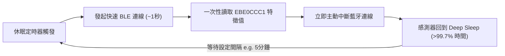

# MijiaTempBar 🌡️💧🔋

[](https://github.com/liaw-boy/mijia-temp-bar/releases)
[](https://www.apple.com/macos/)
[](linux/README.md)
[](https://swift.org/)
[](https://www.python.org/)
[](LICENSE)

專為 **小米 / 米家藍牙溫濕度計 2（LYWSD03MMC）** 打造的原生跨平台（macOS & Linux）狀態列監控與即時歷史儀表板工具。

支援出廠**原廠韌體**（免刷機、出廠即用）與 **第三方開源韌體**（ATC1441 / pvvx / BTHome），獨家採用「**即連即斷 (Connect-Read-Disconnect)**」超省電架構，單顆 CR2032 鈕扣電池續航可達一年以上！

---

## 📸 介面預覽 (Showcase)

### 1. 雙行微型膠囊狀態列 (Menu Bar / Tray)
上下雙行微型膠囊設計（源自 [macbookBatteryMonitor](https://github.com/sgeric910601/macbookBatteryMonitor)），頂天立地吃滿選單列空間，兼顧大字體與極致橫向省空間：

```text
┌─────────────────────────┐
│  [TMP] 24.5°            │  <-- 上排：暖橙色圓角膠囊 TMP ＋ 即時溫度
│  [HUM] 68%              │  <-- 下排：湛藍色圓角膠囊 HUM ＋ 即時濕度
└─────────────────────────┘
      (寬度僅約 40px，極致節省 MacBook 瀏海螢幕選單列空間)
```

同時提供 **5 種顯示樣式** 自由切換：
- **樣式 1：雙行微型膠囊**（預設，最具辨識度）
- **樣式 2：純數字雙行堆疊**（極簡俐落）
- **樣式 3：橫向完整排列**（`24.5°C  68%`）
- **樣式 4：僅顯示溫度**（`24.5°`）
- **樣式 5：緊湊單行模式**（`24°/68%`）

### 2. 原生即時儀表板與歷史趨勢折線圖 (GUI Dashboard)
快捷鍵 <kbd>⌘</kbd> + <kbd>D</kbd> 或點選狀態列選單打開深色毛玻璃儀表板：
- **官方硬體渲染標章**：清晰展示小米官方 LYWSD03MMC 硬體圖示與連線狀態指示燈。
- **三大指標數據卡片**：
  - 🌡️ **即時溫度**（附今日最低 / 最高溫統計）
  - 💧 **相對濕度**（附人體舒適度評估：適宜 / 偏高 / 乾燥）
  - 🔋 **電池電量**（附毫伏級精確即時電壓監控）
- **互動式向量折線圖**：
  - **📊 綜合總覽**：同屏同步繪製 **溫度 (°C)**、**濕度 (%)**、**電池電量 (%)** 三條歷史曲線，自動對齊雙 Y 軸百分比刻度。
  - **分頁專題走勢**：支援切換「🌡️ 溫度走勢 / 💧 濕度走勢 / 🔋 電壓回彈」。
  - **智慧避讓懸停氣泡 (Hover HUD)**：滑鼠移動時同步標記三色光暈點位，當數值位於圖表頂端時自動翻轉避讓，確保資訊絕不遮蔽。
  - **CSV 數據匯出**：一鍵將完整採樣歷史匯出為標準 CSV 格式。

---

## 🌟 核心特色 (Core Highlights)

### ⚡ 獨家「即連即斷 (Connect-Read-Disconnect)」超省電架構
原廠韌體預設在 BLE GATT 連線期間會開啟 Notify，每 6 秒發送一次射頻訊號，導致微型 CR2032 鈕扣電池承受劇烈負載內阻壓降 (Voltage Sag)，幾天內電壓即從 2.9V 跌破 2.85V。

本專案研發「**即連即斷**」極致省電演算法：

- **連線 1 秒即斷**：完全關閉 GATT Notify，讀取一次數據後立即調用 `cancelPeripheralConnection`。
- **電池電壓完美回彈**：感測器 99.7% 時間處於 Deep Sleep 休眠，鈕扣電池電壓顯著回升（實測從 2.854V 回彈至 2.880V+），續航延長至一年以上！

### ⏱️ 彈性可調連線間隔（支援自訂分鐘）
選單支援快速切換預設間隔或彈窗輸入任意分鐘數：
- `30 秒`：即時調試模式
- `1 分鐘` / `3 分鐘`：一般動態監控
- `5 分鐘`：**推薦平衡模式**（預設）
- `10 分鐘` / `15 分鐘` / `30 分鐘`：深度省電模式
- `1 小時` / `2 小時`：**超省電休眠模式**（連線 1 秒、休眠 3599 秒）
- `自訂時間 (分鐘)...`：支援任意整數分鐘（如 45、90、120 分鐘等）。

### 🔔 低電量智慧預警與推播通知 (Low Battery Notification)
CR2032 鈕扣電池在壽命末期（電壓跌破 2.60V）會進入斷崖式崩塌放電，幾天內即會完全耗盡：
- **雙重健康門檻診斷**：當電量 $\le 15\%$ 或電壓 $\le 2.60\text{V}$ 時，自動觸發低電量預警。
- **macOS 原生系統橫幅推播 (UserNotifications)**：即時彈出 macOS 系統通知，提醒及早備妥並更換 CR2032 電池。
- **24 小時防干擾冷卻機制**：每日最多提醒一次，絕不產生通知轟炸。換上新電池後自動復位重置。
- **狀態列與選單視覺化警示**：狀態列選單與儀表板卡片同步標記 `⚠️ 電量過低` 紅色醒目標籤，選單亦提供獨立開關隨時關閉或啟用提醒。

### 📍 居家大範圍地理圍欄與在席感知 (Macro Geofencing & Location Gatekeeper)
業界領先的「**兩級階梯式感知架構 (Two-Tier Location Pipeline)**」，完美解決出門在外電腦背景輪詢的耗電疑慮：
- **大範圍地理圍欄總開關**：結合 macOS 原生 `CoreLocation`（100m 粗定位）與居家網路閘道（Gateway MAC/IP）建立雙重定位錨點。
- **出門離家徹底斷電 (Away Mode)**：一旦帶著筆電離開居家大範圍（半徑 100m ~ 1000m 可調），軟體**完全終止一切藍牙連線與背景定時器**，進入 0 射頻、0 CPU 負載的徹底停機休眠！
- **進門回家自動喚醒 (Home Mode)**：走入家門大範圍或連回家中網路瞬間，1 秒內自動喚醒藍牙連線，狀態列無感浮現最新數值！
- **一鍵標定與即時距離監控**：選單提供「📌 記錄目前位置為居家中心」，並即時顯示距離狀態（如 `🏠 範圍內 (距家 15m)` / `🚗 範圍外 (距家 850m · 停機)`）。

### 🔌 原廠出廠與開源韌體雙模自動相容
- **原廠官方韌體**：免刷機、出廠即用，直接透過 BLE GATT 協議精準讀取。
- **開源自製韌體**：自動嗅探並解析 ATC1441、pvvx、BTHome v2 廣播封包。

### 👻 智慧隱藏與自動秒連
- 啟用「**僅連線時顯示**」後，帶著筆電外出或超出藍牙範圍時，選單列圖示會**自動完全隱藏**，保持桌面乾淨。
- 回到室內藍牙範圍內，數秒內**自動無感重連並重新浮現**。
- 啟動瞬間先讀取本機快取數據，徹底消除選單列閃爍。

---

## 🖥️ 跨平台支援 (macOS & Linux)

本專案提供兩個平台的原生實現：

| 平台 | 技術棧 | 系統匣實作 | 介面渲染 |
| :--- | :--- | :--- | :--- |
| **🍎 macOS** | Swift 6 + AppKit + CoreBluetooth | `NSStatusItem` | CoreGraphics 向量圖形 |
| **🐧 Linux** | Python 3.10+ + BlueZ + bleak | Ayatana AppIndicator (SNI) | GTK 3 + Cairo + Pango |

兩者功能保持 100% 一致（5 種狀態列樣式、即時儀表板、綜合折線圖、CSV 匯出、省電輪詢）。

---

## 📥 安裝與使用 (Installation)

### 🍎 macOS 版本

#### 方式 1：直接下載發行版本（最推薦）
1. 前往 **[Releases 頁面](https://github.com/liaw-boy/mijia-temp-bar/releases)** 下載最新版 `MijiaTempBar-v1.3.0.zip`。
2. 解壓縮後將 `MijiaTempBar.app` 拖移至 `/Applications`（應用程式）資料夾。
3. 雙擊啟動即可！（首次啟動若系統跳出「想使用藍牙」，請點選允許）。

#### 方式 2：從原始碼自行編譯
本專案為純 Swift 原生專案，**零第三方套件依賴**：
```bash
git clone https://github.com/liaw-boy/mijia-temp-bar.git
cd mijia-temp-bar
./bundle.sh
open MijiaTempBar.app
```

#### 開機自動啟動 (Launch at Login)
1. 打開 Mac **系統設定** > **一般** > **登入項目與擴充功能**。
2. 在「**登入時打開**」區域點擊 `+` 號，選取 `MijiaTempBar.app` 即可。

---

### 🐧 Linux 版本

詳細說明請參閱 **[linux/README.md](linux/README.md)**。

#### 1. 安裝系統相依套件
```bash
# Ubuntu / Debian
sudo apt install python3-venv python3-gi python3-gi-cairo gir1.2-gtk-3.0 gir1.2-ayatanaappindicator3-0.1 bluez

# Fedora
sudo dnf install python3-gobject python3-cairo gtk3 libayatana-appindicator-gtk3 bluez

# Arch Linux
sudo pacman -S python-gobject python-cairo gtk3 libayatana-appindicator bluez
```

#### 2. 一鍵安裝（安裝至 `~/.local`，無須 root 權限）
```bash
cd mijia-temp-bar/linux
./install.sh
```
安裝完成後可從應用程式選單啟動「**米家溫濕度狀態列**」，或在終端機輸入 `mijia-temp-bar`。
開機自動啟動可直接在系統匣選單勾選「**開機時自動啟動**」。

---

## 🏷️ 支援硬體規格 (Supported Hardware)

| 設備型號 | 官方名稱 | 支援方式 |
| :--- | :--- | :--- |
| **LYWSD03MMC** | 米家藍牙溫濕度計 2 (代工廠：秒秒測) | **完全支援**（原廠出廠 / 開源韌體雙模） |
| **MJWSD05MMC** | 米家溫濕度計 3 代 | 開源廣播模式完全相容 |
| **MHO-C401** | 秒秒測電子墨水屏溫濕度計 | 開源廣播模式完全相容 |
| **CGG1 / CGDK2** | 青萍藍牙溫濕度計系列 | 開源廣播模式完全相容 |

> **名詞解析（什麼是 LYWSD03MMC？）**：  
> `LYWSD03MMC` 是小米官方出廠在機身背面與藍牙廣播中所使用的正式硬體型號代碼：  
> `L`（藍牙 BLE）+ `Y`（溫）+ `W`（濕）+ `S`（感測器 Sensor）+ `D`（螢幕/電池 Display）+ `03`（第3代專案代號）+ `MMC`（小米生態鏈原廠製造商：北京秒秒測科技有限公司 Miaomiaoce）。  
> 全世界出廠的每一台「米家藍牙溫濕度計 2」都具備這個名稱。

---

## 🛠️ 專案目錄結構 (Project Structure)

```
mijia-temp-bar/
├── Sources/                          # macOS 原生 Swift 原始碼
│   ├── main.swift                    # AppKit 生命週期與常駐模式進入點
│   ├── StatusBarController.swift     # 狀態列介面、雙行微型膠囊渲染、下拉選單
│   ├── BluetoothManager.swift        # CoreBluetooth 藍牙搜尋、即連即斷省電讀取、廣播解析
│   ├── DashboardWindowController.swift # 即時儀表板視窗、硬體渲染卡片、舒適度評估
│   ├── ChartView.swift               # CoreGraphics 雙 Y 軸、三線走勢圖、時間比例 X 軸、HUD 氣泡
│   ├── HistoryManager.swift          # 歷史資料持久化、JSON 儲存、CSV 匯出
│   ├── NotificationManager.swift     # 低電量預警診斷、macOS 系統橫幅推播、24h 防干擾冷卻
│   ├── LocationGatekeeper.swift      # 居家大範圍地理圍欄、網路閘道錨點、離家停機與進門喚醒
│   └── Logger.swift                  # 輕量本機除錯日誌 (/tmp/mijia_temp_bar.log)
├── Resources/
│   └── device.png                    # 小米官方 LYWSD03MMC 硬體高解析透明圖
├── generate_icon.swift               # Google Stitch Vibe Design 原生圖示生成腳本
├── bundle.sh                         # 一鍵編譯、資源打包與 Ad-hoc 本機簽名腳本
├── linux/                            # Linux 移植版本 (Python + GTK + AppIndicator + BlueZ)
│   ├── README.md                     # Linux 版專屬使用與架構手冊
│   ├── install.sh / uninstall.sh     # Linux 一鍵安裝與解除安裝腳本
│   ├── requirements.txt              # Python 套件清單 (bleak)
│   ├── mijia_temp_bar/               # Linux 核心模組 (對應 macOS 各 Swift 元件)
│   ├── screenshots/                  # Linux 介面截圖
│   └── tests/                        # 單元測試 (廣播解析、歷史紀錄)
├── LICENSE                           # MIT 開源授權
└── README.md                         # 專案主說明文件
```

---

## 📄 授權條款 (License)

本專案採用 [MIT License](LICENSE) 授權開放原始碼。歡迎社群提交 Issue 與 Pull Request！
