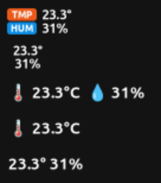
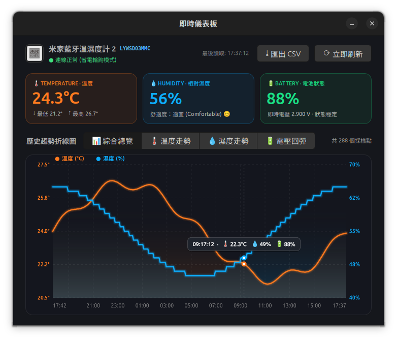
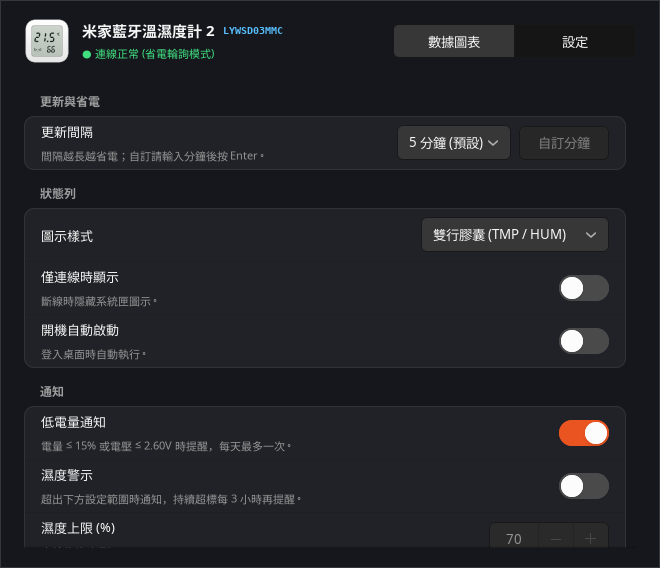

# MijiaTempBar for Linux

[](#系統需求-requirements)
[](https://www.python.org/)

MijiaTempBar 的 Linux 移植版本：在桌面系統匣（GNOME 頂部面板 / KDE 系統匣）即時顯示 **小米 / 米家藍牙溫濕度計 2（LYWSD03MMC）** 的溫濕度，核心功能與 macOS 版相同（不含 Wi-Fi／GPS 居家感應停機，桌面環境通常不需要）。

<p>
  
  
  
</p>

---

## 功能 (Features)

- **多台溫濕度計**：從選單「搜尋新裝置…」掃描約 20 秒後勾選加入（不會自動加入鄰居的）；狀態列顯示一台「主裝置」，選單列出每一台的溫濕度並可切換、改名、移除。每台的讀取、歷史、退避與通知各自獨立，一台連不到不影響其他台。
- **與 macOS 版相同的 5 種狀態列樣式**：雙行微型膠囊 `[TMP] / [HUM]`、純數字雙行堆疊、橫向完整、僅溫度、緊湊單行。
- **原廠韌體「即連即斷」省電讀取**：透過 BlueZ GATT 讀取一次數據後立即斷線，讓硬體回到 Deep Sleep。
- **開源韌體廣播**：自動解析 ATC1441 / pvvx / BTHome v2（未加密）廣播。
- **連線間隔**：30 秒 ~ 2 小時預設值，或自訂任意分鐘數。
- **僅連線時顯示**：所有裝置都超出藍牙範圍時自動隱藏圖示，回到範圍內自動重連並重新出現；主裝置連不到但其他台還在時，狀態列數字顯示 `--`。
- **即時儀表板**（從選單開啟的彈出視窗，點視窗外或按 Esc 收起）：三大指標卡片、隨數據變化的裝置示意圖、總覽（溫度／濕度／電量）／溫度／濕度／電壓折線圖、6 小時／24 小時／7 天／全部時間範圍、滑鼠懸停數值提示、一鍵匯出 CSV。
- **設定分頁**：裝置清單（顯示在狀態列／改名／移除／搜尋新裝置）、更新間隔（含自訂分鐘）、圖示樣式、僅連線時顯示、開機自動啟動、低電量通知、濕度警示（上限／下限）。
- **離線指數退避**：設備連續連不上時，重試間隔依 60 秒 → 5 分鐘 → 15 分鐘拉長，避免藍牙空轉。
- **低電量通知**：電量 ≤ 15% 或電壓 ≤ 2.60V 時發出桌面通知（標題帶裝置名稱），每台裝置 24 小時內不重複，可在設定分頁關閉。
- **版本更新檢查**：設定分頁可手動檢查，啟動時每天自動檢查一次 GitHub release（只認 `linux-v` 前綴的 tag，例如 `linux-v1.2.0`）；只提示，不自動安裝。
- **開機自動啟動**：在儀表板的設定分頁開關（Linux 版新增）。

---

## 系統需求 (Requirements)

- Python 3.10 以上、BlueZ 5（`bluetooth` 服務）、GTK 3、Ayatana AppIndicator
- 支援 StatusNotifierItem 系統匣的桌面環境
  - **GNOME**：需要 AppIndicator 擴充套件（Ubuntu 預設已啟用；其他發行版請安裝 `gnome-shell-extension-appindicator`）
  - KDE Plasma、XFCE、Cinnamon、Budgie 等：內建支援（寬版圖示的顯示效果依各桌面而定）
- 已實機測試環境：Ubuntu 24.04 / GNOME 46（X11）＋ LYWSD03MMC 原廠韌體

---

## 安裝 (Installation)

### 1. 安裝系統套件

```bash
# Ubuntu / Debian
sudo apt install python3-venv python3-gi python3-gi-cairo gir1.2-gtk-3.0 gir1.2-ayatanaappindicator3-0.1 bluez

# Fedora
sudo dnf install python3-gobject python3-cairo gtk3 libayatana-appindicator-gtk3 bluez

# Arch Linux
sudo pacman -S python-gobject python-cairo gtk3 libayatana-appindicator bluez
```

### 2. 執行安裝腳本（安裝到 `~/.local`，不需要 root）

```bash
git clone https://github.com/liaw-boy/mijia-temp-bar.git
cd mijia-temp-bar/linux
./install.sh
```

安裝完成後從應用程式選單開啟「**米家溫濕度狀態列**」，或在終端機執行 `mijia-temp-bar`。
需要開機自動啟動時，在儀表板的「設定」分頁打開「**開機自動啟動**」即可。

### 移除

```bash
./uninstall.sh          # 保留歷史數據與設定
./uninstall.sh --purge  # 一併刪除歷史數據、設定與日誌
```

### 直接從原始碼執行（開發用）

```bash
cd mijia-temp-bar/linux
python3 -m venv --system-site-packages .venv
.venv/bin/pip install -r requirements.txt
.venv/bin/python -m mijia_temp_bar

# 單元測試 (不需要藍牙或圖形介面)
python3 -m unittest
```

---

## 操作方式

- **左鍵** 點擊圖示：開啟選單——每台裝置一列（✓ 為狀態列顯示的主裝置，子選單可切換主裝置、立即更新、改名、移除）、搜尋新裝置、全部立即更新、開啟儀表板、結束；間隔、樣式、通知等在儀表板的「設定」分頁。
- **儀表板** 標題的下拉選單可切換要看的裝置；卡片、圖表、匯出 CSV 與「立即更新」都跟著所選裝置。
- **中鍵** 點擊圖示：直接開啟即時儀表板。
- 圖示因「僅連線時顯示」而隱藏時，從應用程式選單再次啟動即可暫時喚回圖示並開啟儀表板。

---

## 檔案位置

| 用途 | macOS 版 | Linux 版 |
| --- | --- | --- |
| 偏好設定 (含裝置清單 `Devices`、主裝置 `PrimaryDeviceID`) | UserDefaults | `~/.config/mijia-temp-bar/settings.json` |
| 歷史數據 (每台一個檔) | `~/Library/Application Support/MijiaTempBar/history/<裝置>.json` | `~/.local/share/mijia-temp-bar/history/<藍牙位址>.json` |
| 除錯日誌 | `~/Library/Logs/MijiaTempBar/mijia_temp_bar.log` | `~/.local/state/mijia-temp-bar/mijia_temp_bar.log` |
| 即時狀態 JSON (頂層為主裝置，`devices` 陣列為每一台) | `~/Library/Application Support/MijiaTempBar/mijia_status.json` | `$XDG_RUNTIME_DIR/mijia-temp-bar/mijia_status.json` |

**從單一裝置版本升級**：第一次啟動會把原本記住的那台 (`TargetAddress`) 加入清單並設為主裝置，舊的 `history.json` 複製到新的每台歷史檔；舊設定鍵與舊檔都保留不動，另存一份 `settings.pre-multidevice.json` 備份。

---

## 常見問題 (Troubleshooting)

- **系統匣看不到圖示**：GNOME 請確認 AppIndicator 擴充套件已啟用（`gnome-extensions list --enabled`）。
- **一直顯示「搜尋溫濕度計中」**：確認電腦藍牙已開啟（`bluetoothctl show`）、溫濕度計在附近，且沒有被手機米家 App 等其他裝置連線佔用。
- **換了另一台或想多加一台**：從選單「搜尋新裝置…」勾選加入；不要的那台從它的子選單「移除此裝置…」（歷史檔會保留）。
- **搜尋不到**：原廠韌體的溫濕度計同一時間只能有一個藍牙連線，請先關閉手機米家 App；開源韌體請確認廣播未加密。
- **詳細連線紀錄**：查看 `~/.local/state/mijia-temp-bar/mijia_temp_bar.log`。

---

## 專案結構 (與 macOS 版對照)

```text
linux/
├── mijia_temp_bar/
│   ├── __main__.py / app.py  # GTK 應用程式生命週期與單一實例常駐   (main.swift)
│   ├── status_bar.py         # AppIndicator 系統匣圖示與多裝置狀態  (StatusBarController.swift)
│   ├── device_menu.py        # 系統匣選單的裝置區段                 (DeviceMenuBuilder.swift)
│   ├── device_dialogs.py     # 搜尋新裝置、改名、移除視窗           (DeviceSearchWindowController.swift)
│   ├── settings_devices.py   # 設定分頁的「裝置」區塊
│   ├── devices.py            # 裝置清單、主裝置與舊版設定遷移       (DeviceStore.swift / Migration.swift)
│   ├── device_state.py       # 每台狀態、隱藏與 -- 顯示規則         (SensorModels.swift)
│   ├── scheduler.py          # 一次只讀一台的輪詢排程與退避         (Backoff.swift)
│   ├── discovery.py          # 搜尋候選分類                         (DeviceDiscovery.swift)
│   ├── status_file.py        # 即時狀態 JSON                        (StatusFile.swift)
│   ├── bluetooth.py          # BlueZ (bleak) 掃描、GATT 即連即斷    (BluetoothManager.swift)
│   ├── parsers.py            # 原廠 GATT / ATC / pvvx / BTHome 解析
│   ├── history.py            # 歷史數據保存與 CSV 匯出             (HistoryManager.swift)
│   ├── dashboard.py          # 彈出式儀表板與設定分頁                    (DashboardWindowController.swift)
│   ├── chart.py              # Cairo 歷史趨勢折線圖                 (ChartView.swift)
│   ├── icons.py              # 狀態列膠囊影像與 App 圖示            (generate_icon.swift)
│   ├── settings.py           # 偏好設定與 XDG 路徑                  (UserDefaults)
│   ├── logger.py             # 本機除錯日誌                         (Logger.swift)
│   └── autostart.py          # XDG 開機自動啟動
├── tests/                    # 解析、裝置清單、遷移、排程、搜尋、通知等單元測試
├── install.sh / uninstall.sh # 使用者層級安裝 / 移除腳本
└── requirements.txt          # bleak
```
